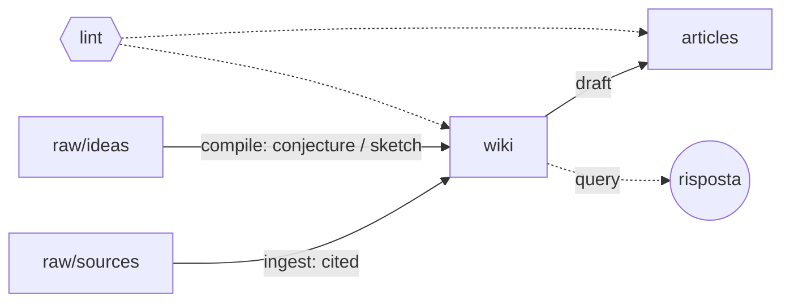

# Math LLM-Wiki — Specifica v0.1

Oct 6, 2026 · @Michele

## Scopo

Questo documento definisce un sistema per scrivere articoli di matematica con l'aiuto di un LLM, basato su una wiki mantenuta dall'agente. Ha due lettori: chi lo usa, che ci trova l'idea e le regole, e Claude Code, che lo usa per imbastire il repository.

È una versione 0.1: le regole sono una prima ipotesi da verificare sul campo. Ogni scelta marcata come aperta va decisa prima del bootstrap o durante il primo test.

## Problema e idea

In un progetto di più articoli si perde il tessuto connettivo: la notazione fissata, chi dipende da cosa, da quale fonte è nata un'idea, cosa è dimostrato e cosa no. Il sistema affida all'LLM la manutenzione di questo tessuto, lasciando a te il giudizio matematico.

L'architettura riprende l'**LLM Wiki** di Andrej Karpathy (aprile 2026): fonti grezze immutabili, una wiki di file Markdown scritta e mantenuta dall'LLM, un file di schema con le regole. Lo stato dei risultati e il grafo delle dipendenze si ispirano ai **blueprint di Lean** (leanblueprint di Patrick Massot).

Le differenze rispetto al pattern originale sono quattro:

- il raw è diviso in fonti esterne e idee personali, con pesi diversi;
- ogni enunciato ha uno stato epistemico e una provenienza obbligatoria;
- esiste un livello di articoli separato dalla wiki;
- il lint controlla anche i draft, non solo la wiki.

## Principi di design

1. **Il raw è immutabile.** L'agente legge `raw/` ma non lo modifica mai. Le fonti sono la base di verità.
2. **Nessuna affermazione senza provenienza.** Ogni enunciato nella wiki indica il file di `raw/` o la pagina wiki da cui deriva.
3. **Lo stato lo promuove l'umano.** L'agente può proporre una dimostrazione, ma solo l'autore può marcarla come verificata, del tutto o in parte.
4. **Una sola fonte per la notazione.** La pagina di notazione è vincolante per wiki e articoli.
5. **La wiki è il magazzino, l'articolo è la vetrina.** Gli articoli attingono dalla wiki; un risultato nuovo nasce nella wiki e poi entra nell'articolo.
6. **Tutto è testo.** Markdown con LaTeX inline (`$...$`) e display (`$$...$$`), leggibile in Obsidian e versionato con git. Gli articoli restano in Markdown; il `.tex` si genera solo in uscita.
7. **Un'operazione alla volta, con l'umano nel ciclo.** Ingest e compile procedono una fonte o un'idea per volta, con un riepilogo delle modifiche.
8. **Lingua inglese.** Wiki, articoli, frontmatter e messaggi del changelog sono in inglese, anche quando le fonti o le idee sono in altre lingue.

## Struttura delle cartelle

Il repository ha tre livelli di contenuto (raw, wiki, articoli) più i file di controllo per l'agente.

```text
math-llm-wiki/
├── CLAUDE.md              # schema: regole per l'agente
├── README.md              # cos'è e come si usa
├── raw/
│   ├── sources/           # fonti esterne, immutabili (pdf convertiti in .md, appunti di lezioni)
│   │   └── _registry.md   # elenco fonti con id, citazione, data di ingest
│   └── ideas/             # idee personali, datate (YYYY-MM-DD-titolo.md)
├── wiki/
│   ├── index.md           # indice di tutte le pagine con riassunto di una riga
│   ├── notation.md        # notazione e convenzioni vincolanti
│   ├── open-questions.md  # domande aperte
│   ├── definitions/
│   ├── results/           # lemmi, proposizioni, teoremi, congetture
│   ├── examples/          # esempi e controesempi
│   ├── concepts/          # pagine discorsive su un tema
│   └── sources/           # una scheda per fonte
├── articles/
│   └── <slug-articolo>/
│       ├── plan.md        # obiettivo, pubblico, risultati usati
│       ├── draft.md       # sorgente dell'articolo, sempre Markdown
│       └── build/         # output generato da /export (.tex, .bib), mai modificato a mano
├── templates/             # template delle pagine wiki
└── log/
    └── changelog.md       # registro delle operazioni dell'agente
```

I nomi dei file wiki sono slug stabili (`def-spazio-compatto.md`, `thm-baire.md`). Lo slug è anche l'id usato nei link `[[...]]`, compatibili con Obsidian.

## Tipi di pagina e frontmatter

Ogni pagina wiki ha un frontmatter YAML che l'agente legge e il lint controlla. I tipi previsti sono sei.

| Tipo | Cartella | Prefisso slug | Contenuto |
| --- | --- | --- | --- |
| definizione | `definitions/` | `def-` | enunciato, esempi minimi, varianti in letteratura |
| risultato | `results/` | `lem-`, `prop-`, `thm-`, `conj-` | enunciato, dimostrazione o sketch, dipendenze |
| esempio | `examples/` | `ex-`, `cex-` | costruzione, cosa illustra o smentisce |
| concetto | `concepts/` | `con-` | sintesi discorsiva, collegamenti |
| fonte | `sources/` | `src-` | riassunto della fonte, risultati estratti |
| domanda | `open-questions.md` | `q-` (ancora) | domanda, motivazione, tentativi |

Template per una pagina di risultato:

```markdown
---
id: thm-esempio
type: result
kind: theorem          # lemma | proposition | theorem | conjecture
status: sketch         # vedi sezione Stati epistemici
provenance:
  - raw/sources/autore2024.md#teorema-3.1
  - raw/ideas/2026-10-06-idea.md
depends_on: [def-x, lem-y]
used_in: [articles/primo-articolo]
notation_checked: false
updated: 2026-10-06
---

# Teorema (nome breve)

**Enunciato.** Sia $X$ ...

**Dimostrazione.** (oppure **Sketch.** / **Riferimento.**)

**Note.** varianti, ipotesi indebolibili, collegamenti.
```

Gli altri tipi usano lo stesso frontmatter senza i campi non pertinenti (ad esempio una definizione non ha `kind`).

Campi aggiuntivi: un risultato `partial` ha `unchecked_steps`, l'elenco dei passaggi non ancora controllati; una pagina `src-` ha `reliability` (vedi **Affidabilità delle fonti**). Per ora si crea una pagina solo per i risultati riutilizzati; i lemmi tecnici usati una volta restano dentro la dimostrazione che li usa.

## Stati epistemici

Ogni risultato ha uno e un solo stato. In un articolo, `verified` e `cited` si usano liberamente, `partial` solo con un avviso del lint; gli altri stati non sono ammessi come fatti.

| Stato | Significato | Chi lo assegna | Usabile in un articolo |
| --- | --- | --- | --- |
| `conjecture` | enunciato ritenuto vero, nessuna dimostrazione | agente o autore | solo come congettura dichiarata |
| `sketch` | idea di dimostrazione con passaggi mancanti | agente o autore | no |
| `proposed` | dimostrazione completa scritta dall'agente, non controllata | solo agente | no |
| `partial` | dimostrazione controllata dall'autore solo in parte; la pagina elenca i passaggi non controllati | solo autore | sì, con avviso del lint |
| `verified` | dimostrazione completa controllata dall'autore | solo autore | sì |
| `cited` | dimostrato in una fonte di `raw/sources/`, con riferimento preciso | agente, confermato dall'autore | sì, con citazione; avviso se la fonte è `preprint` o `informal` |
| `refuted` | falso; la pagina punta al controesempio | agente o autore | no |

Regole di promozione:

- l'agente non porta mai un risultato a `verified`; può solo segnalare che è pronto per la verifica;
- `cited` richiede il numero dell'enunciato nella fonte (teorema, pagina);
- se un risultato da cui altri dipendono scende di stato, l'agente segnala tutte le pagine e gli articoli che lo usano;
- lo stato di un risultato non supera mai quello della sua dipendenza più debole (lo calcola il lint).

### Affidabilità delle fonti

Quanto un risultato è fissato dalla comunità è una proprietà della fonte, non del risultato, e per questo è un asse separato dallo stato. Ogni fonte ha un campo `reliability` nel registro e nella sua scheda `src-`.

| Livello | Esempi | Effetto sui risultati `cited` |
| --- | --- | --- |
| `standard` | manuali, monografie, risultati classici | nessun avviso |
| `refereed` | articoli pubblicati su rivista con revisione | nessun avviso |
| `preprint` | arXiv non ancora pubblicato, articoli recenti | avviso del lint quando usato in un articolo |
| `informal` | dispense, slide, blog, comunicazioni personali | avviso del lint; consigliata verifica |

Un risultato `cited` da una fonte `preprint` o `informal` può passare a `partial` o `verified` quando l'autore ne controlla la dimostrazione. Se la fonte cambia livello (ad esempio un preprint viene pubblicato), l'autore aggiorna il registro e il lint ricalcola gli avvisi.

## Operazioni

Il sistema ha sei operazioni, invocate dall'autore con un comando esplicito (in Claude Code: un comando slash per ciascuna). Le prime cinque fanno parte della v0.1; `export` è prevista per dopo il primo test.



Fonti e idee entrano nella wiki con stati diversi; il lint controlla sia la wiki sia gli articoli, mentre query legge la wiki senza modificarla.

**`ingest <file>`** — porta una fonte nuova nella wiki.

1. Registra la fonte in `raw/sources/_registry.md` (id, citazione completa, data).
2. Crea la scheda `wiki/sources/src-<id>.md` con riassunto e risultati estratti.
3. Per ogni definizione o risultato rilevante crea o aggiorna la pagina wiki con stato `cited`.
4. Segnala conflitti con la notazione o con pagine esistenti, senza risolverli da solo.
5. Scrive un riepilogo in `log/changelog.md` e lo mostra all'autore.

**`compile <idea>`** — porta un'idea personale nella wiki. Come ingest, ma i risultati entrano come `conjecture` o `sketch` e la provenienza punta a `raw/ideas/`.

**`query <domanda>`** — risponde usando prima `wiki/index.md`, poi le pagine collegate, e cita gli slug usati. Se la risposta produce materiale nuovo, propone di salvarlo come pagina.

**`draft <articolo>`** — lavora su `articles/<slug>/`. Legge `plan.md`, usa solo risultati `cited` o `verified`, rispetta `notation.md`, e aggiorna `used_in` nelle pagine wiki citate.

**`lint`** — controllo di salute, senza modifiche automatiche. Produce un rapporto con:

- risultati usati in un articolo con stato non ammesso;
- simboli nei draft o nella wiki in conflitto con `notation.md`;
- dipendenze mancanti, circolari o verso pagine inesistenti;
- stati incoerenti con quelli delle dipendenze;
- pagine senza provenienza, orfane o assenti da `index.md`;
- definizioni usate in un articolo prima di essere introdotte.

Il rapporto distingue **errori** (stato non ammesso in un articolo, notazione in conflitto, dipendenze rotte) da **avvisi** (risultati `partial`, risultati `cited` da fonti `preprint` o `informal`). Gli avvisi non bloccano, ma l'elenco completo deve essere visibile prima di chiudere un articolo.

**`export <articolo>`** *(prevista)* — genera in `articles/<slug>/build/` il `.tex` e il `.bib` a partire da `draft.md`. Converte i link `[[...]]` in riferimenti interni o citazioni, applica le macro di `notation.md` e allega un report con gli avvisi del lint ancora aperti. Il sorgente resta il Markdown: le correzioni si fanno lì e si riesporta.

## Regole per l'agente

Queste regole sono il nucleo del futuro `CLAUDE.md`. Sono scritte come istruzioni dirette all'agente.

1. Non modificare, rinominare o cancellare nulla in `raw/`.
2. Ogni enunciato che scrivi nella wiki ha una provenienza nel frontmatter. Se non sai da dove viene, non scriverlo.
3. Non assegnare mai gli stati `verified` o `partial`. Quando una dimostrazione `proposed` ti sembra completa, aggiungila alla lista "da verificare" nel changelog.
4. Non inventare riferimenti: numero di teorema, pagina e citazione devono comparire nella fonte.
5. Prima di introdurre un simbolo, controlla `notation.md`. Se manca, proponi una voce; se è in conflitto, segnalalo e fermati.
6. Le idee in `raw/ideas/` non sono fatti. Non promuoverle mai a `cited`.
7. Distingui sempre tra quello che la fonte dice e la tua interpretazione: la seconda va in una sezione **Note** marcata.
8. Dopo ogni operazione aggiorna `wiki/index.md` e `log/changelog.md`.
9. In un articolo usa risultati `cited`, `verified` o `partial`; per i `partial`, e per i `cited` da fonti `preprint` o `informal`, aggiungi nel draft un commento `<!-- check: ... -->`. Per gli altri stati, segnala il buco invece di colmarlo.
10. Se una richiesta contraddice queste regole, chiedi conferma all'autore.

## Bootstrap con Claude Code

Per imbastire il repository, dai questo documento a Claude Code con l'istruzione: *"Leggi la specifica e crea il repository seguendo la sezione Bootstrap."*

Compiti per Claude Code:

1. Crea la struttura di cartelle della sezione **Struttura delle cartelle**, con file vuoti o segnaposto dove indicato.
2. Scrivi `CLAUDE.md` a partire dalle sezioni **Principi**, **Stati epistemici**, **Operazioni** e **Regole per l'agente**.
3. Crea in `templates/` un template per ogni tipo della tabella **Tipi di pagina**.
4. Crea un comando slash per ciascuna operazione (`/ingest`, `/compile`, `/query`, `/draft`, `/lint`) in `.claude/commands/`, ognuno con i passi descritti.
5. Scrivi uno script `scripts/lint.py` per i controlli meccanici: frontmatter valido, link `[[...]]` risolti, dipendenze esistenti e acicliche, stato calcolato dalle dipendenze. I controlli che richiedono giudizio (notazione, ordine delle definizioni) restano al comando `/lint` dell'agente.
6. Scrivi `README.md` con l'idea in breve, le origini (Karpathy, leanblueprint) e come si usa.
7. Inizializza git e fai un primo commit.

Claude Code non deve inventare contenuto matematico in questa fase: il repository nasce vuoto, pronto per il primo ingest.

## Domande aperte e piano di test

Da decidere prima o durante il primo test:

- [x] **Deciso:** wiki e articoli in inglese (principio 8).
- [x] Draft in Markdown fino alla fine : **deciso**, il `.tex` si genera con `export`.
- [ ] Granularità: per ora una pagina **solo per i risultati riutilizzati**. Da verificare nel test se serve scendere ai lemmi tecnici.
- [ ] Conversione delle fonti PDF in Markdown: da decidere dopo i primi ingest, provando più strumenti.
- [x] **Deciso:** aggiunto lo stato `partial` e il campo `reliability` per le fonti (standard, refereed, preprint, informal).
- [ ] I quattro livelli di affidabilità bastano, o serve distinguere ad esempio tra preprint con e senza riscontri dalla comunità?

### Piano di test

Due test in combinatoria, area vicina ma non coincidente con quella dell'autore (algebra): abbastanza familiare da riconoscere gli errori dell'agente, abbastanza lontana da non lavorare a memoria. Il primo verifica il meccanismo base, il secondo lo mette sotto stress. Insieme coprono tutti gli stati e tutti i livelli di affidabilità.

**Test 1 — Congettura della sensitività (Huang, 2019).** Dimostrazione breve ed elementare, pubblicata sugli Annals of Mathematics.

| Fonte | Ruolo | `reliability` |
| --- | --- | --- |
| Huang, *Induced subgraphs of hypercubes and a proof of the Sensitivity Conjecture* (2019) | teorema principale | `refereed` |
| Gotsman–Linial (1992) | riduzione dalla congettura a un enunciato sull'ipercubo | `refereed` |
| un manuale di algebra lineare | interlacciamento di Cauchy | `standard` |
| una dispensa o un post divulgativo sulla dimostrazione | presentazione alternativa | `informal` |

Cosa verifica:

- grafo di dipendenze piccolo e completo: ipercubo, `s(f)`, `bs(f)`, matrice con segni, interlacciamento, teorema finale;
- coerenza di notazione tra fonti che usano simboli diversi;
- `compile` di 2–3 idee personali (ad esempio analoghi per altri grafi) come `conjecture` o `sketch`;
- un articolo divulgativo breve scritto con `/draft`.

**Test 2 — La bunkbed conjecture è falsa (Gladkov, Pak, Zimin, 2024).** Controesempio ottenuto adattando ai grafi un controesempio per ipergrafi (Hollom). Prima dell'ingest, verificare se il lavoro è stato pubblicato e impostare `reliability` di conseguenza.

Cosa verifica:

- stato `refuted` e pagine di controesempio `cex-`;
- catena di dipendenze più lunga, da ipergrafi a grafi;
- fonti `preprint` e relativi avvisi del lint;
- risultati `partial`, perché alcuni passaggi sono pesanti o assistiti da calcolo e difficilmente verranno controllati tutti.

Alternativa al test 2, più probabilistica: Park–Pham, dimostrazione della congettura di Kahn–Kalai.

Procedura per entrambi i test:

1. Raccogliere le fonti in `raw/sources/` e scrivere 2–3 idee personali in `raw/ideas/`.
2. Fare l'ingest una fonte alla volta e controllare a mano ogni pagina creata, annotando gli errori dell'agente.
3. Introdurre di proposito un conflitto di notazione e un risultato `sketch` usato in un draft, per vedere se il lint li intercetta.
4. Scrivere il `plan.md` e un frammento di articolo con `/draft`.
5. Registrare in `log/test-notes.md` cosa ha funzionato, cosa no e quanto tempo ha richiesto.
6. Dopo entrambi i test, aggiornare questa specifica alla v0.2.
